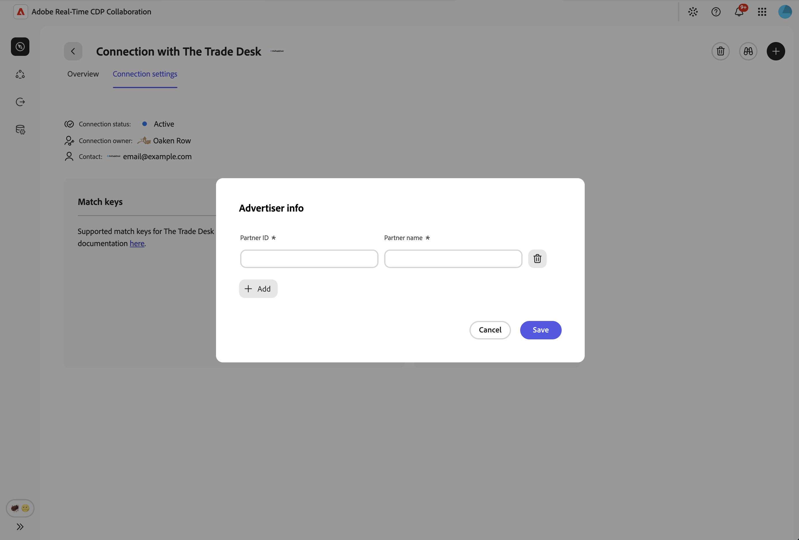

# Paid-to-owned enrichment (Beta)

Export enrichment attributes derived from REDS, the impression-log data feed from [!DNL The Trade Desk], to add paid-media context to first-party profiles.

After the CSV file is delivered to your [!DNL Amazon S3] export destination, ingest it separately into [!DNL Adobe Real-Time CDP] to update profiles. Exporting alone does not update profiles or activate an experience.

Ad exposure provides context, not proof of engagement, purchase intent, or personal interests. Use the signals alongside your first-party behavior and consent information.

## Prepare for enrichment {#prepare-for-enrichment}

Work with your administrator, media team, and data team to prepare the following resources:

* Access to the connection, project, and enrichment workflow in [!DNL Adobe Real-Time CDP Collaboration].
* An advertiser account with [!DNL The Trade Desk] and access to the relevant REDS logs.
* First-party audiences sourced into [!DNL Adobe Real-Time CDP Collaboration].
* An [!DNL Amazon S3] export destination configured for enrichment output.
* A separate ingestion process to load the delivered file into [!DNL Adobe Real-Time CDP].

### Authorize the source feed {#authorize-source-feed}

Work with your Adobe representative and [!DNL The Trade Desk] to complete an access letter. The letter authorizes Adobe to access the relevant REDS logs.

[!DNL The Trade Desk] provisions the source feed, and Adobe configures access and ingestion. Before creating a project, confirm that the connection is active and the feed is ready.

The partner-managed source bucket contains the ad logs. Your export destination receives the derived enrichment file. The source bucket and export destination serve different purposes.

### Prepare downstream ingestion {#prepare-downstream-ingestion}

Before ingesting an export, have your data team confirm the delivered identifiers, identity namespaces, and attribute mappings. Use these details to prepare ingestion into the intended sandbox, schema, and dataset.

## Connect and create projects {#connect-create-projects}

To use enrichment, establish a connection with [!DNL The Trade Desk] and create a project. If you already have a connection and project, open the project to select attributes.

### Connect with the partner {#connect-partner}

To find [!DNL The Trade Desk], open the collaborator catalog:

1. In **[!UICONTROL Connect]**, open **[!UICONTROL Discover collaborators]**.
1. Search for [!DNL The Trade Desk].
   ![The [!UICONTROL Discover collaborators] page showing a card for [!DNL The Trade Desk] with the [!UICONTROL Connect] option.](../../../assets/collaborate/advertising-platforms/discover-collaborators-trade-desk.png){zoomable="yes"}
1. Select **[!UICONTROL Connect]** on the listing and complete the connection workflow.
   ![The Connect to [!DNL The Trade Desk] dialog explains REDS authorization and Partner ID setup.](../../../assets/collaborate/advertising-platforms/trade-desk-connection-instructions.png){zoomable="yes"}
1. After the connection is active, open **[!UICONTROL Connection settings]**. In **[!UICONTROL Advertiser info]**, select **[!UICONTROL Edit]** to update existing information or **[!UICONTROL Add]** to enter new information.
   ![Active [!DNL The Trade Desk] connection settings showing Advertiser info and the Edit control.](../../../assets/collaborate/advertising-platforms/trade-desk-connection-settings.png){zoomable="yes"}
1. Enter your [!DNL The Trade Desk] Partner ID in **[!UICONTROL Partner ID]** and the partner name in **[!UICONTROL Partner name]**, then select **[!UICONTROL Save]**. Find the Partner ID in your [!DNL The Trade Desk] account under **[!UICONTROL Seat Identifiers]**.
   {zoomable="yes"}

After the connection is established, create a project.

### Create a project {#create-project}

To organize your enrichment work, create a project for the connection:

1. In **[!UICONTROL Collaborate]**, select **[!UICONTROL My Projects]**.
1. Select **[!UICONTROL Create a project]**, or select the add icon ().
1. In **[!UICONTROL Create project]**, select [!DNL The Trade Desk] from **[!UICONTROL Collaborator]**.
   ![The [!UICONTROL Create project] form showing [!DNL The Trade Desk] as an option in the [!UICONTROL Collaborator] list and the [!UICONTROL Project name] and [!UICONTROL Description] fields.](../../../assets/collaborate/advertising-platforms/trade-desk-create-project.png){zoomable="yes"}
1. Enter a **[!UICONTROL Project name]** and **[!UICONTROL Description]**, then choose an image to identify the project.
1. To create the project, select **[!UICONTROL Create]**.

For general project management, use the [Create and manage projects guide](/help/guide/collaborate/manage-projects.md).

## Select and export attributes {#select-export-attributes}

To export enrichment attributes, use **[!UICONTROL Enrich]** in your project:

1. Open the project and select **[!UICONTROL Enrich]**.
1. Select the attributes that support your use case.
   ![The [!UICONTROL Enrich] page showing selectable signal cards grouped by category, with coverage values.](../../../assets/collaborate/advertising-platforms/enrich-attribute-selection.png){zoomable="yes"}
1. To understand signal availability, review the coverage for each selected attribute.
1. Choose the [!DNL Amazon S3] export destination configured for enrichment output.
   ![The [!UICONTROL Choose a destination] screen with a [!UICONTROL Destination] list and the [!UICONTROL Enrich profiles] action.](../../../assets/collaborate/advertising-platforms/enrich-choose-destination.png){zoomable="yes"}
1. Review the selected attributes and destination, then request an export.
   {zoomable="yes"}

Submitting an export request does not confirm file delivery. Verify that the file has arrived before starting ingestion.

### Available enrichment signals {#available-signals}

Select from 18 curated signals across four categories. Custom enrichment expressions are not available.

| Category | Signal | Description |
| --- | --- | --- |
| Core | [!UICONTROL Last exposed date] | When an identity was most recently exposed to an ad. |
| Core | [!UICONTROL Exposure count] | An exposure-frequency category, rather than a raw impression count. |
| Core | [!UICONTROL Prospecting vs retargeting] | An inferred classification of ad exposure as prospecting or remarketing. |
| Core | [!UICONTROL Product category shown] | An inferred category for the products promoted in the ads. |
| Core | [!UICONTROL Dominant inventory channel] | The main inventory channel associated with ad exposure. |
| Core | [!UICONTROL Dominant device type] | The main device type associated with ad exposure. |
| Geography | [!UICONTROL City] | City information from advertising context, not a verified home address. |
| Geography | [!UICONTROL Region / State] | Region or state information from advertising context. |
| Geography | [!UICONTROL DMA] | Designated market area (DMA) information from advertising context. |
| Connected television (CTV) | [!UICONTROL CTV exposed] | Ad exposure on a connected television device. |
| Connected television (CTV) | [!UICONTROL Live stream viewer] | Ad exposure in live-stream inventory, not proof of viewing or engagement. |
| Connected television (CTV) | [!UICONTROL PMP / premium exposure] | Private marketplace (PMP) or private-contract exposure, not independently verified premium inventory. |
| Content affinity | [!UICONTROL Connected TV / Streaming] | Ad exposure associated with streaming content. |
| Content affinity | [!UICONTROL Gamer] | Ad exposure associated with gaming content, sites, or apps. |
| Content affinity | [!UICONTROL Sports fan] | Ad exposure associated with sports content, sites, or apps. |
| Content affinity | [!UICONTROL News follower] | Ad exposure associated with news content, sites, or apps. |
| Content affinity | [!UICONTROL Music lover] | Ad exposure associated with music content, sites, or apps. |
| Content affinity | [!UICONTROL Content genre] | The content genre associated with ad exposure. |

Geography describes advertising context, not a verified home or current location. Content affinity signals do not establish personal preferences. Missing source information can result in missing attribute values.

### Attribute coverage {#attribute-coverage}

Coverage describes how often processed records include values for an attribute. Coverage is not an identity match rate or the proportion of first-party profiles that will receive attributes.

Identity matching, source-signal availability, and downstream ingestion affect profile updates. Coverage does not confirm that an export has completed or that profiles have changed.

### Workflow scope {#workflow-scope}

Use the curated catalog for [!DNL The Trade Desk] enrichment. Raw-log export and custom attribute expressions are not available.

Enrichment-opportunity discovery, overlap analysis, and attribution or incrementality measurement are not part of the enrichment workflow.

## Ingest and validate results {#ingest-validate-results}

After delivery, have your data team ingest the file into [!DNL Adobe Real-Time CDP]. Keep export verification separate from profile validation:

1. Confirm that the CSV file has arrived in the intended [!DNL Amazon S3] location.
1. Check that the file contains the expected identifiers and selected attributes.
1. Ingest the file using the confirmed identity and schema mappings for the intended sandbox and dataset.
1. Review ingestion results and verify that a sample of expected profiles contains the enrichment attributes.

An exported file does not establish that profiles have been updated. Each subsequent export also requires separate ingestion to update profiles.

## Troubleshoot enrichment {#troubleshoot-enrichment}

Use the following checks to distinguish source-data, export, and ingestion issues:

| Issue | What to check |
| --- | --- |
| The connection or **[!UICONTROL Enrich]** is unavailable | Ask your administrator to confirm connection and project access. Confirm that source-feed setup is complete. |
| No export destination is available | Ask your administrator to confirm that a destination is configured and available for enrichment output. |
| An attribute has limited coverage | Review source-data availability with your media team. Do not interpret coverage as a profile match rate. |
| An export was requested, but no file is present | Verify the intended destination with your data team. Request submission does not confirm delivery. |
| A delivered file has not updated profiles | Check ingestion results and the confirmed identity and schema mappings. Export and ingestion are separate operations. |

## Next steps {#next-steps}

After you ingest and validate the attributes, [build audiences in Real-Time CDP](https://experienceleague.adobe.com/en/docs/experience-platform/segmentation/ui/audience-builder){target="_blank"} using enrichment signals and first-party data.

Next, make the audiences available to your existing personalization or journey tools. To deliver audiences through a destination, follow the [audience activation guide](https://experienceleague.adobe.com/en/docs/experience-platform/destinations/ui/activate/activation-overview){target="_blank"}.
