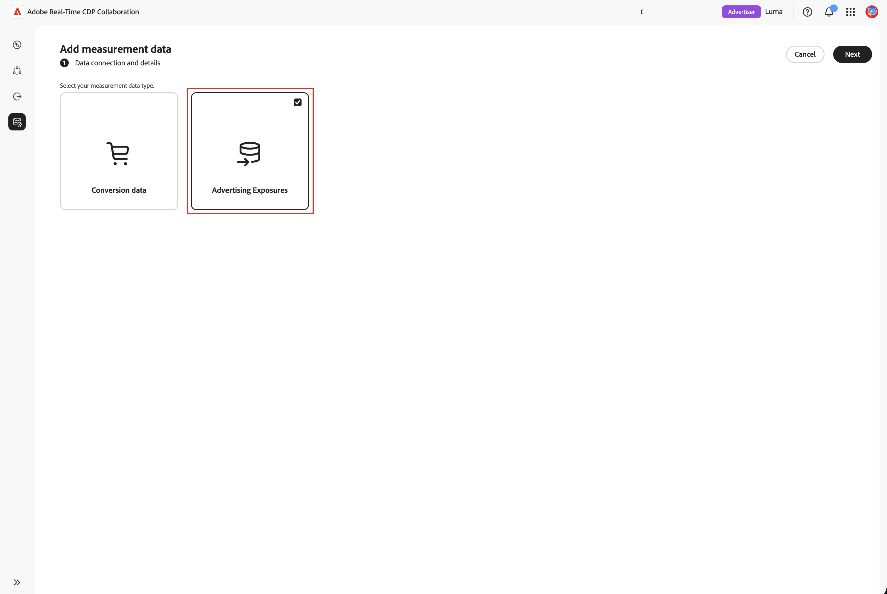
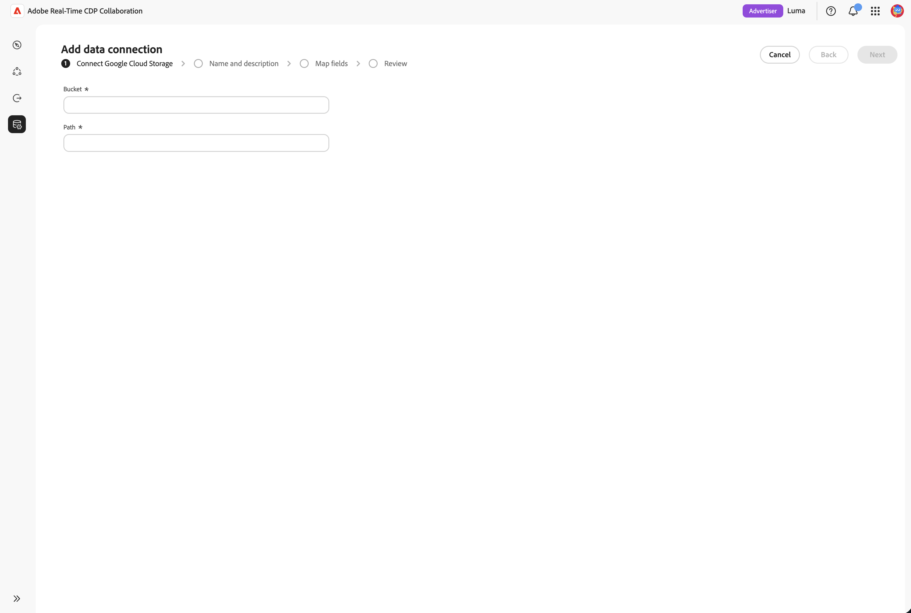
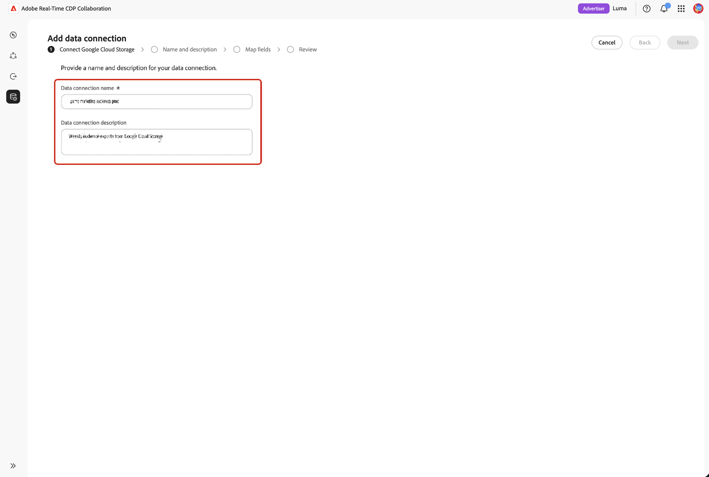

# Configure [!DNL Google Cloud Storage] for advertising exposure sourcing

Connect your [!DNL Google Cloud Storage] (GCS) bucket to Adobe Real-Time CDP Collaboration to source advertising exposure (ad log) data for measurement.

The Measurement module in Real-Time CDP Collaboration connects advertiser conversion data with publisher ad exposure logs to deliver privacy-centric campaign reporting. This adds a self-serve, no-code path for advertisers and publishers. You can bring the ad exposure (impression) logs you already keep in [!DNL Google Cloud Storage] into Measurement for attribution, without an Adobe Experience Platform dependency and without Adobe-assisted (white-glove) setup. You connect a bucket, confirm the detected data matches the ad log schema Measurement expects, and finish in minutes.

Data is not pulled at connection time. Sourcing is triggered when you run a measurement report. To minimize storage, Adobe automatically deletes sourced ad logs after a 7-day retention period.

Governance and data-handling rules for ad logs sourced from [!DNL Google Cloud Storage] match the rules that apply to data sourced from Adobe Experience Platform.

>[!NOTE]
>
>This guide covers sourcing advertiser and publisher **ad logs** (advertising exposures) from cloud storage. Sourcing conversion data from cloud storage is not currently supported.

## Prerequisites {#prerequisites}

Complete all items in this section before starting the configuration workflow. Before following this guide, you must have completed [account onboarding and setup](./onboard-account.md).

### GCS access and permissions {#gcs-access-permissions}

You or your [!DNL Google Cloud] administrator must grant Adobe read-only access to your GCS bucket before starting the wizard. For step-by-step instructions, see [Set up Google Cloud Storage permissions](#setup-gcs-permissions).

Cloud storage ad log sourcing availability varies by region. If sourcing is not yet enabled in your region, confirm with your Adobe account representative.

### Prepare your ad log data {#prepare-adlog-data}

Your ad log files must conform to the [ad log schema](#ad-log-schema) before sourcing begins. Key requirements include:

* **File format:** CSV only.
* **Canonical column headers:** Files must use the canonical column headers defined in the [ad log schema](#ad-log-schema). This version does not support per-column remapping or automated schema mapping.
* **Required fields:** All required fields must be present, along with at least one match key.
* **Match key hashing:** Match key hash values must be lowercase hexadecimal SHA-256. Multiple values within a single identity field are pipe-delimited (`|`).
* **Column consistency:** Every file at your configured path must share an identical column layout.
* **Subfolders:** Files must sit directly at the specified path. Collaboration does not traverse subfolders.

## Connect ad logs in the wizard {#connect-adlogs}

Use the following steps to connect your GCS ad logs from within Collaboration.

1. From the **[!UICONTROL Setup]** workspace, select **[!UICONTROL My measurement data]**, then select the add icon and choose **[!UICONTROL Measurement data]**.

   {zoomable="yes"}

2. In the **[!UICONTROL Add measurement data]** workflow, select **[!UICONTROL Advertising Exposures]** as your measurement data type, then select **[!UICONTROL Next]**.

   {zoomable="yes"}

3. To import your measurement data, select **[!UICONTROL Add a new data connection]**, then select **[!UICONTROL Next]**.

   {zoomable="yes"}

4. Select the data source for your new data connection: **[!UICONTROL Google Cloud Storage]**. Select **[!UICONTROL Next]**.

   {zoomable="yes"}

5. The **[!UICONTROL Add data connection]** wizard opens. In the **[!UICONTROL Connect Google Cloud Storage]** step, provide the **[!UICONTROL Bucket]** and **[!UICONTROL Path]** where your ad log files live. Both fields are required, and all files at the configured path are treated as one dataset.

   {zoomable="yes"}

6. In the **[!UICONTROL Name and description]** step, provide a **[!UICONTROL Data connection name]** (required) and an optional **[!UICONTROL Description]** for the data connection.

   {zoomable="yes"}

7. In the **[!UICONTROL Map fields]** step, preview the detected columns to confirm the wizard read the right files, then review the [ad log schema](#ad-log-schema), which lists every field Measurement understands, which fields are required versus optional, and which detected columns are recognized as identity/match keys. This step is read-only validation: the system confirms the required headers are present and blocks you if a required field is missing. There is no per-column remapping in this version.

   {zoomable="yes"}

8. In the **[!UICONTROL Review]** step, review and finish. The connection appears in the measurement data area with its status, which remains **pending** until the first measurement report run sources data.

## How ad log sourcing works {#how-it-works}

Ad log sourcing from [!DNL Google Cloud Storage] mirrors the high-level flow used for audience sourcing:

1. **Cloud storage connection:** you configure read-only access to a bucket that holds your ad logs.
2. **Schema review and validation:** the system validates your files against the ad log schema (folder, file, and required-header checks; read-only).
3. **Field mapping:** source identity fields are automatically mapped to canonical fields based on the canonical column names. There is no manual remapping.
4. **Ingestion and normalization:** events are normalized to one row per exposure (or accepted aggregates). Ingestion is triggered ad hoc by the measurement report run date.
5. **Measurement readiness:** sketches and indexes are built to support downstream queries and attribution. Adobe deletes sourced data after 7 days.

### Ad log schema (canonical CSV format) {#ad-log-schema}

Required fields must be present, and at least one field marked **Join Key (one-of required)** in the following table must also be present. Multiple values in a single identity field are pipe-delimited (`|`). Match key hash values are lowercase hexadecimal SHA-256.

| Field | Data Type | Required | Description |
| --- | --- | --- | --- |
| `EVENT_DATETIME` | String (ISO 8601) | Required | Timestamp of the event |
| `EVENT_ID` | String | Optional | Unique ID for the event |
| `EVENT_TYPE` | String (enum) | Required | Type of event. One of `{impression, click}` |
| `HASHED_EMAIL_SHA_256` | String (64-char hex) | Join Key (one-of required) | Lowercase hex SHA-256 of email; multiple values pipe-delimited |
| `HASHED_IPV4_SHA_256` | String (64-char hex) | Join Key (one-of required) | Lowercase hex SHA-256 of IPv4; multiple values pipe-delimited |
| `DEVICE_ID` | String (64-char hex) | Join Key (one-of required) | Device advertising ID; multiple values pipe-delimited |
| `DEVICE_ID_TYPE` | String (enum) | Optional | One of `{idfa, gaid, aaid, rida, afai, msai, vida, lgudid, tifa}` |
| `ECID` | String (64-char hex) | Join Key (one-of required) | Demdex-based ECID; multiple values pipe-delimited |
| `CUSTOM_ID` | String | Optional | Publisher/partner persistent ID (for example, PPID, RampID, Core ID) |
| `ADVERTISER_ID` | String | Required | Unique identifier for the advertiser |
| `ADVERTISER_NAME` | String | Optional | Advertiser/brand name |
| `CAMPAIGN_ID` | String | Required | Platform-specific campaign identifier |
| `CAMPAIGN_NAME` | String | Optional | Human-readable campaign name |
| `PLACEMENT_ID` | String | Required | Unique identifier for the placement |
| `PLACEMENT_NAME` | String | Optional | Descriptive placement name |
| `CREATIVE_ID` | String | Optional | Unique identifier for the ad creative |
| `CREATIVE_NAME` | String | Optional | Human-readable creative name |
| `AUDIENCE_ID` | String | Optional | Audience segment identifier |
| `AUDIENCE_NAME` | String | Optional | Human-readable audience name |
| `DEVICE_TYPE` | String (enum) | Optional | One of `{mobile, desktop, tablet, ctv, dooh, car, in_store, other}` |
| `AD_FORMAT` | String (enum) | Optional | One of `{display, video, native, audio, search, commerce, dooh, other}` |
| `SITE_NAME` | String | Optional | Network/site/app/publisher property where the impression occurred |
| `TEST_GROUP` | String | Optional | Grouping for lift studies, test/control, holdout groups |
| `CUSTOM_DIM` | String | Optional | Additional publisher dimension |

{style="table-layout:auto"}

>[!NOTE]
>
>`MATCH_KEY_TYPE` is included as an optional field in the schema so that, over time, multiple ID types can be supported in parallel and match-key provenance (email, phone, or CRM) can be preserved without breaking the v1 contract.

### Validation requirements (v1) {#validation-requirements}

The system validates ad log source data before you complete the setup workflow. Validation checks:

* The source folder must contain at least one file.
* Files cannot be empty.
* Required schema headers must be present.
* Optional schema fields may be omitted.
* Files containing only the required fields are valid.

Validation failures prevent you from proceeding. The system does **not** validate data types, field values, record completeness, data quality, or automated schema mapping. Validation is limited to folder, file, and required-header checks for this initial release.

## Known limitations {#known-limitations}

Be aware of the following constraints when configuring and using [!DNL Google Cloud Storage] ad log sourcing:

* **Ad logs only:** This connection sources advertiser or publisher ad logs (advertising exposures). Conversion data is not supported.
* **Supported sources:** [!DNL Google Cloud Storage] and [!DNL Azure Data Lake Storage] or [!DNL Azure Blob Storage].
* **File format:** CSV only.
* **Canonical headers required:** There is no per-column remapping and no intelligent/automated mapping. Your files must use the canonical column names.
* **No value/type validation:** Only required column headers are validated. Initially, there may be no data rows.
* **No editing a connection after creation:** Any change, including changing the active match keys, requires creating a new connection.
* **One layout per path:** All files at the path must share one identical column layout. Mixed layouts can cause partial sourcing failures.
* **Subfolders not traversed:** Files must sit directly at the specified path.
* **No schedule or look-back at setup:** Sourcing is ad hoc at report run time. Look-back is set when the report is configured.

## Troubleshooting {#troubleshooting}

* **Connection shows pending / no data:** This is expected until the first measurement report run. No data is sourced at connection time.
* **"No data found" at the source step:** The folder is empty. Add files before proceeding.
* **Preview shows no columns:** The file is present but empty (no headers or content).
* **Cannot get past validation:** A required column header is missing. Confirm the required fields and at least one match key are present, using canonical names.
* **Unrecognized columns:** Non-canonical column names are not picked up as known fields. Rename them to the canonical format; there is no remapping in this version.
* **Sourcing fails after setup:** Confirm that Adobe's read access to the bucket has not changed and that files still exist at the configured path in canonical format.
* **Report date range not fully covered:** Remember the 7-day automatic data expiration. Logs older than 7 days may not be available for the requested range.

## Set up [!DNL Google Cloud Storage] permissions {#setup-gcs-permissions}

To allow Adobe to read from your GCS bucket, create a custom IAM role with the following permissions:

| Permission | Purpose |
| ------------- | --------------- |
| `storage.buckets.get` | Read bucket metadata. |
| `storage.objects.get` | Read object data and metadata. |
| `storage.objects.list` | List objects in a bucket. |

{style="table-layout:auto"}

Grant this custom role to the Adobe Google Service Account for your region (NA, EMEA, or Australia). Completing this setup requires **Google Cloud Account Admin** privileges.

## Upgrade or migration considerations {#upgrade-migration}

* Customers previously onboarded via Experience Platform or Adobe-assisted (white-glove) setup can move to the self-serve cloud storage path. Existing measurement reports and flows are unchanged.
* Match keys present in ad log files must be enabled for the Collaboration account, as with audience sourcing.
* Governance and data-handling rules match data sourced from Experience Platform.

## Next steps {#next-steps}

After sourcing completes, your ad logs are available for measurement reporting.

For other advertising exposure sourcing methods, see [Configure Azure storage for advertising exposure sourcing](./configure-azure-adlog-sourcing.md).
