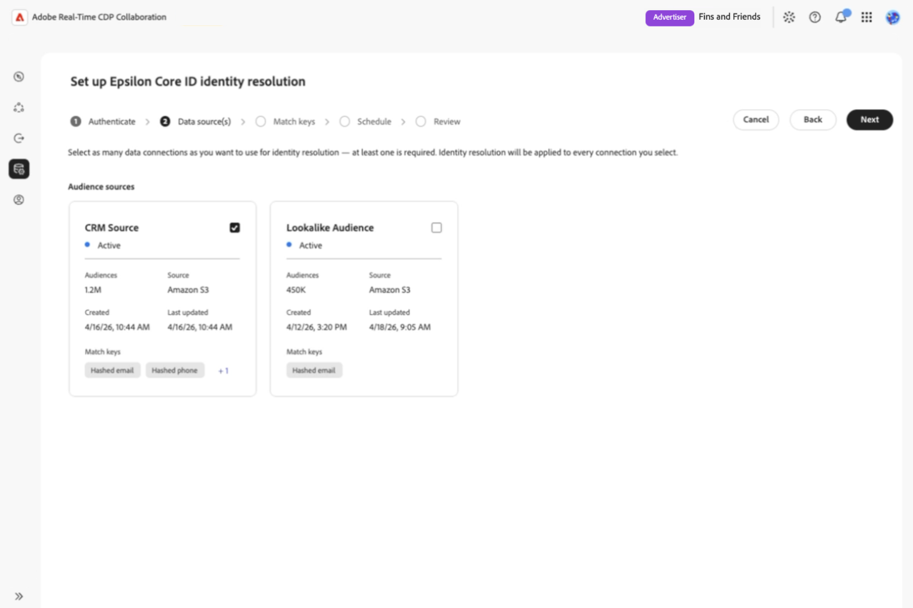

# Set up and manage identity resolution

{{limited-availability-release-note}}

Identity resolution helps you identify customers you have in common with collaborators, even when your organizations use different identifiers. Configure and manage identity resolution with supported identity providers in Real-Time CDP Collaboration, without building custom integrations for each partner.

>[!NOTE]
>
>The steps and screenshots in this guide use [!DNL Epsilon Core ID] as an example. Requirements and available options may differ depending on your identity provider.

>[!AVAILABILITY]
>
>At launch, only [!DNL Epsilon Core ID] is available for configuration. Epsilon Core ID identity resolution is only available for Real-Time CDP Collaboration accounts provisioned in the United States.

## Prerequisites {#prerequisites}

Before you begin, make sure you have:

* **Account-management permissions.** You must have **[!UICONTROL Manage Account]** and **[!UICONTROL Manage Collaboration Instances]** permissions.
* **At least one audience data connection.** You need an existing audience data connection to configure identity resolution. [Set up audience sourcing](./source-overview.md) if needed. Measurement data connections are not supported.
* **Supported match keys and fields.** Each audience data connection must contain data supported by your identity provider. If using account-level match keys, such as hashed email or hashed phone, enable them for your account and map them to your audience data. Name and Postal address fields are mapped during audience data connection setup and do not require account-level enablement. See [account match keys](./onboard-account.md#edit-match-keys) and [audience field mapping](./onboard-audiences.md#map-fields).

During identity resolution setup, you can choose which available identifiers to use.

>[!NOTE]
>
>For Epsilon Core ID, you need your Epsilon customer number, available from your Epsilon account representative. You can use hashed email, hashed phone, or Name together with Postal address for identity resolution. If using Name and Postal address, map at least one field under each. Name and Postal address values are not hashed.

## Configure identity resolution {#configure-identity-resolution}

Select an identity provider to begin configuring identity resolution. In this [!DNL Epsilon Core ID] example, you'll choose audience data connections and match keys, set a date range, and review your selections before confirming the configuration.

To begin, select **[!UICONTROL Setup]** in the left navigation followed by the **[!UICONTROL Identity resolution]** tab to view the available identity providers.

### Select an identity provider {#select-identity-provider}

Locate the card for your identity provider and review its supported region and match keys. Select **[!UICONTROL Setup]** to begin.

{zoomable="yes"}

Before starting the configuration workflow, Collaboration checks for a data connection and compatible match keys. If a requirement is missing, a dialog appears to guide the process. Follow the action in the dialog:

* **[!UICONTROL Data connection required]:** Select **[!UICONTROL Set up data connection]** to configure an audience data connection. See [Source and manage audiences](./source-overview.md).
* **[!UICONTROL Match key required]:** Select **[!UICONTROL Edit match keys]** to enable a supported key. See [Edit match keys](./onboard-account.md#edit-match-keys).

If both are missing, the data connection dialog appears first. After fixing the prerequisites, return to **[!UICONTROL Identity resolution]** and select **[!UICONTROL Setup]** again.

### Authenticate with your identity provider {#authenticate-with-provider}

In the **[!UICONTROL Authenticate]** step, provide the information required by your identity provider. For Epsilon Core ID, enter your customer number in **[!UICONTROL Epsilon customer number]**. Select **[!UICONTROL Next]** to continue.

{zoomable="yes"}

If you are unsure of your Epsilon customer number, contact your Epsilon representative. The customer number format is not validated during setup.

### Select data connections {#select-data-connections}

Next, choose which audience data connections you want to use for identity resolution. This determines which audience data will be used to match your customer identities with your identity provider.

For Epsilon Core ID, all audiences within each selected connection, including those added later, are included. You cannot select individual audiences.

If the connection you want isn't listed, [set up the audience data connection](./source-overview.md) before continuing.

Under **[!UICONTROL Data source(s)]**, select the checkbox for each connection you want to include in **[!UICONTROL Audience sources]**. You must select at least one connection. Select **[!UICONTROL Next]** to continue.

{zoomable="yes"}

### Configure match keys {#configure-match-keys}

In the **[!UICONTROL Match keys]** step, choose which match keys to use for identity resolution for each selected connection. Turning off a key excludes it from identity resolution for that connection without changing your account-level match keys or field mappings.

Review the available keys for each connection and turn off any you don't want to use. Leave at least one eligible match key enabled per connection, then select **[!UICONTROL Next]** to continue.

{zoomable="yes"}

If an expected option is missing, check the [account match keys](./onboard-account.md#edit-match-keys) and [audience field mappings](./onboard-audiences.md#map-fields).

### Set an identity resolution schedule {#set-schedule}

Choose the start and end dates for identity resolution. Identity resolution follows the schedule of your audience data connection, so you cannot set a separate refresh frequency.

In the **[!UICONTROL Schedule]** step, select the calendar control under **[!UICONTROL Date range]** and choose your dates. Select **[!UICONTROL Next]** to continue.

{zoomable="yes"}

### Review and confirm the configuration {#review-and-confirm}

In the **[!UICONTROL Review]** step, check your authentication details, selected audience data connections, match keys, and schedule. To make changes, select **[!UICONTROL Edit]** beside the relevant section.

You cannot edit the configuration after setup. To make changes later, you must delete it and set it up again. Once you're satisfied with your selections, select **[!UICONTROL Confirm and schedule]**.

{zoomable="yes"}

A confirmation dialog indicates that identity resolution has been configured successfully. The first identity resolution run starts **PLACEHOLDER**.

<!-- [Question: Does the first identity resolution run happen immediately after setup, or at the next scheduled audience data connection refresh?] -->

## Manage identity resolution {#manage-identity-resolution}

After confirming your setup, you're automatically returned to the **[!UICONTROL Identity resolution]** tab, where you can view or delete your configuration.

### View configuration details {#view-configuration-details}

To review your configuration, select **[!UICONTROL View details]** on your configured identity provider's card.

Verify the authentication details, selected audience data connections, match keys, and date range. You can also view the configuration status and creation and update information.

{zoomable="yes"}

### Change an existing configuration {#edit-configuration}

You cannot edit a Core ID configuration after setup. To change the Epsilon customer number, selected connections, match keys, or date range, [delete the configuration](#delete-configuration) and complete the [setup workflow](#configure-identity-resolution) again.

<!-- Question: Do other providers have the same limitation? -->

### Delete an identity resolution configuration {#delete-configuration}

To delete a configuration, navigate to **[!UICONTROL Setup]** > **[!UICONTROL Identity resolution]** and select **[!UICONTROL Delete]** on your configured identity provider's card. Review the confirmation dialog, then select **[!UICONTROL Delete]** to confirm.

Deleting the configuration **PLACEHOLDER**. If you want to use this identity provider again, you'll need to [set up a new configuration](#configure-identity-resolution).

<!-- [UNVERIFIED: Does deletion affect previously resolved identifiers, future processing, or both? Confirm before publication.] -->

## Troubleshoot setup issues {#troubleshoot}

If you cannot begin setup because a data connection or match key is missing, follow the instructions under [Select an identity provider](#select-identity-provider).

For Epsilon Core ID, check the following:

* **Not available in your region:** Epsilon Core ID is available only for Collaboration accounts provisioned in the United States.
* **Epsilon customer number unavailable:** Contact your Epsilon representative to obtain your customer number.
