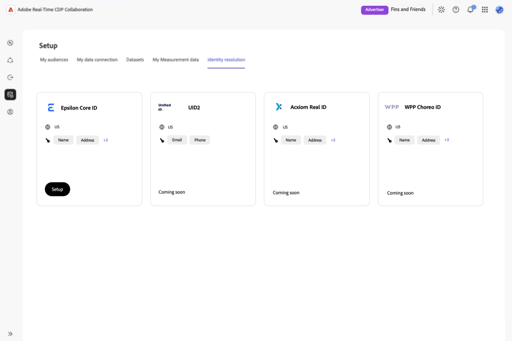
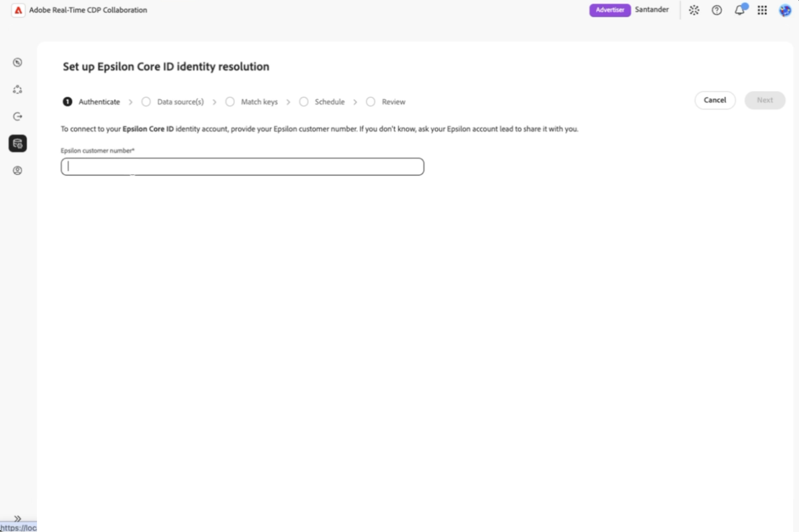
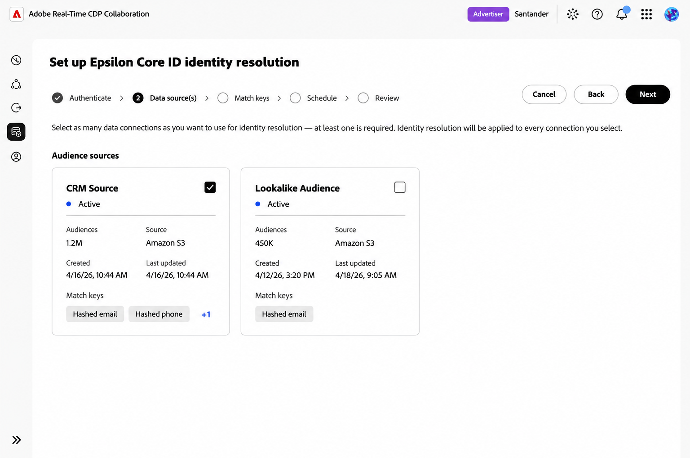
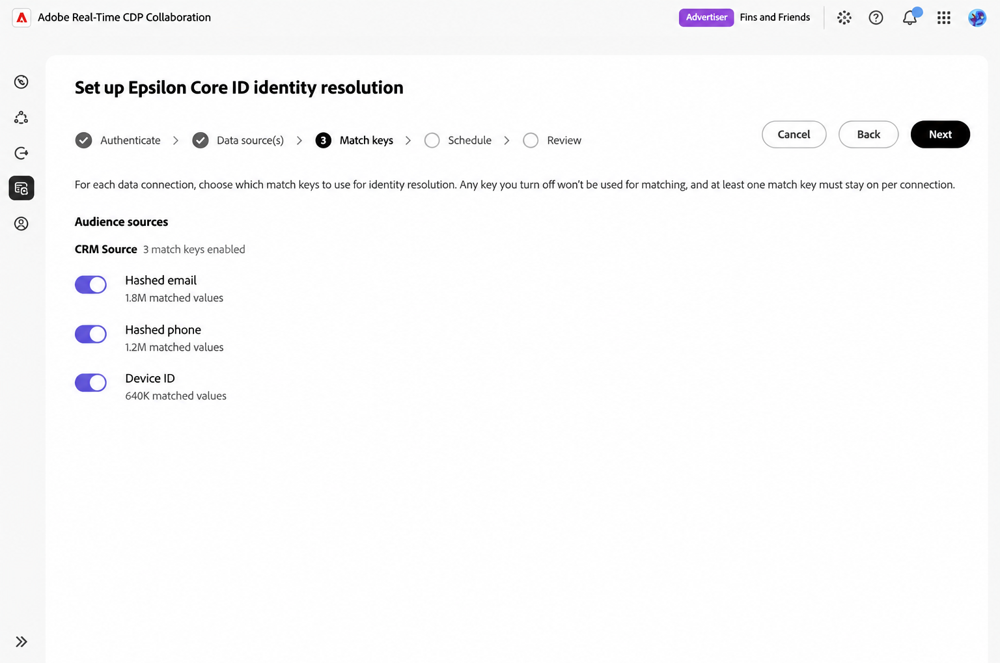
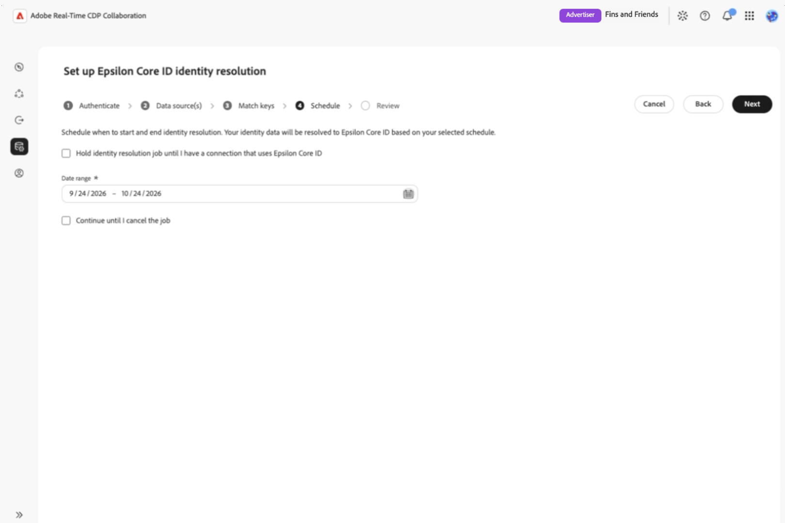
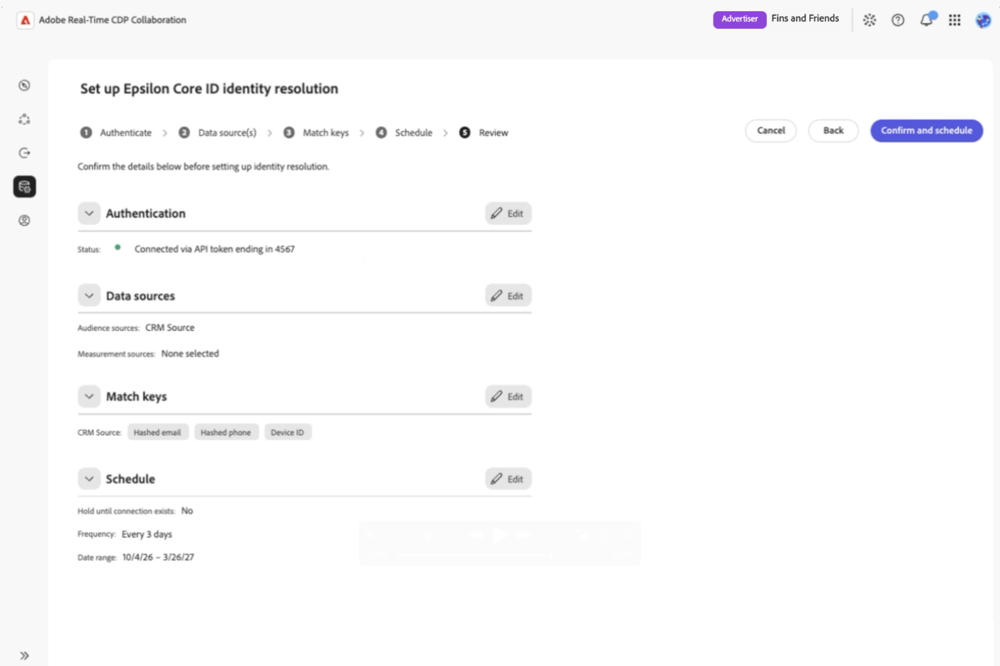
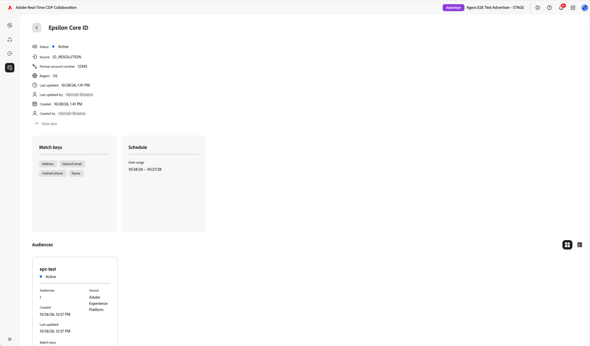

# Set up and manage identity resolution with [!DNL Epsilon Core ID]

{{limited-availability-release-note}}

Identity resolution matches identifiers in your audience data to Epsilon Core IDs, which you can use as match keys with supported collaborators. This guide explains how to configure and manage identity resolution in Real-Time CDP Collaboration.

## Prerequisites {#prerequisites}

Before you begin, make sure you have:

* **A US-provisioned Collaboration account.** Epsilon Core ID is available to US accounts in this release.
* **Account-management permissions.** You must be an account administrator or have permission to manage the account. <!-- [UNVERIFIED: Confirm the exact permission name and scope. The KT says "Manage Account"; existing documentation refers to "Manage Collaboration Instances".] -->
* **At least one audience data connection.** [Set up audience sourcing](./source-overview.md) if needed. Measurement data connections are not supported for Core ID at launch.
* **Supported match keys.** The selected data connection must have hashed email, hashed phone, or both Name and Postal address enabled and mapped. For the Name and Postal address option, map at least one subcomponent of each key. See [account match keys](./onboard-account.md#edit-match-keys) and [audience field mapping](./onboard-audiences.md#map-fields).
* **Your Epsilon customer number.** Obtain this from your Epsilon account representative.

>[!NOTE]
>
>Enable match keys at the account level, map audience source fields to those keys, then choose which mapped keys to use in the identity resolution wizard. Name and Postal address values are not hashed.

## Configure identity resolution {#configure-identity-resolution}

In **[!UICONTROL Setup]**, select Epsilon Core ID and complete the authentication, data source, match key, schedule, and review steps.

### Select an identity provider {#select-identity-provider}

Navigate to **[!UICONTROL Setup]** > **[!UICONTROL Identity resolution]** to open the identity provider catalog. Locate the **[!UICONTROL Epsilon Core ID]** card and review its supported region and match keys. Select **[!UICONTROL Setup]** to begin.

{zoomable="yes"}

<!-- [UNVERIFIED: This prototype catalog displays providers planned for future releases. Replace or validate the image against the launch catalog.] -->

Before opening the wizard, Collaboration checks for a data connection and compatible match keys. If a requirement is missing, follow the action in the dialog:

* **[!UICONTROL Data connection required]:** Select **[!UICONTROL Set up data connection]** to configure an audience data connection. See [Source and manage audiences](./source-overview.md).
* **[!UICONTROL Match key required]:** Select **[!UICONTROL Edit match keys]** to enable a supported key. See [Edit match keys](./onboard-account.md#edit-match-keys).

If both are missing, the data connection dialog appears first. After fixing the prerequisites, return to **[!UICONTROL Identity resolution]** and select **[!UICONTROL Setup]** again.

Accounts outside the supported region show **[!UICONTROL Not available in your region]** on the provider card.

<!-- [UNVERIFIED: The available prerequisite-dialog screenshots show TransUnion and Acxiom. Use Core ID-specific captures if including those dialogs.] -->

### Authenticate with Epsilon {#authenticate-with-epsilon}

In the **[!UICONTROL Authenticate]** step, enter your number in **[!UICONTROL Epsilon customer number]** to associate the configuration with your Epsilon account. Select **[!UICONTROL Next]** to continue.

{zoomable="yes"}

Check the number with your Epsilon representative if you are unsure it is correct. The initial release does not validate its format.

### Select data connections {#select-data-connections}

Select the audience data connections to use for identity resolution. All audiences within each selected connection, including those added later, are included. You cannot select individual audiences.

If a connection is missing, [set up the audience data connection](./source-overview.md) before continuing.

Under **[!UICONTROL Data source(s)]**, review the cards in **[!UICONTROL Audience sources]** and select the checkbox for each connection you want to include. You must select at least one connection. Select **[!UICONTROL Next]** to continue.

{zoomable="yes"}

<!-- [UNVERIFIED: Replace the manually altered screenshot with an authentic release capture.] -->

### Configure match keys {#configure-match-keys}

Choose which available match keys to use for each selected connection. Disabled keys are excluded from identity resolution for that connection. These selections do not change your account-level match keys or field mappings.

Under **[!UICONTROL Match keys]**, review the available keys for each connection and turn off any you do not want to use. Leave at least one eligible match key enabled per connection, then select **[!UICONTROL Next]** to continue.

{zoomable="yes"}

<!-- [UNVERIFIED: The prototype shows Device ID. Confirm the final Core ID key list and replace this screenshot if needed.] -->

Core ID accepts hashed email, hashed phone, or the combination of Name and Postal address. If a key is missing, check the [account match keys](./onboard-account.md#edit-match-keys) and [audience field mappings](./onboard-audiences.md#map-fields).

### Set an identity resolution schedule {#set-schedule}

Choose the date range for identity resolution. Runs follow the schedule of the underlying audience data connection; you cannot set a separate frequency in the wizard.

Under **[!UICONTROL Schedule]**, select the calendar control for **[!UICONTROL Date range]** and choose the start and end dates. Select **[!UICONTROL Next]** to continue.

{zoomable="yes"}

<!-- [UNVERIFIED: Replace this prototype screenshot. It mentions an API token, measurement sources, and a scheduling hold inconsistent with the confirmed launch workflow.] -->

### Review and confirm the configuration {#review-and-confirm}

Review your authentication details, selected audience data connections, match keys, and schedule under **[!UICONTROL Review]**. To make changes, select **[!UICONTROL Edit]** beside the relevant section.

Once you've confirmed your selections, select **[!UICONTROL Confirm and schedule]**. You cannot edit the configuration after setup; changes require deleting it and setting it up again.

{zoomable="yes"}

<!-- [UNVERIFIED: Replace this prototype screenshot. It mentions an API token, measurement sources, and a scheduling hold inconsistent with the confirmed launch workflow.] -->

A confirmation dialog indicates that the Core ID configuration has been set up. The first identity resolution run starts **PLACEHOLDER**.

<!-- [UNVERIFIED: When does the first run start relative to confirmation and the data connection schedule?] -->

## Manage identity resolution {#manage-identity-resolution}

Return to **[!UICONTROL Setup]** > **[!UICONTROL Identity resolution]** to view or delete your Core ID configuration. Changes to an existing configuration require deleting it and setting it up again.

### View configuration details {#view-configuration-details}

On the configured **[!UICONTROL Epsilon Core ID]** card, select **[!UICONTROL View details]**.

Check that the Epsilon customer number, match keys, date range, and audience data connections match your intended setup. The details page also shows the configuration's status and creation and update information.

{zoomable="yes"}

<!-- [UNVERIFIED: Confirm the action label; the PRD says "View details," while Product says "View." Replace the staging screenshot to remove internal details. Active describes configuration status, not necessarily successful job processing; confirm whether run status is available.] -->

### Change an existing configuration {#edit-configuration}

You cannot edit a Core ID configuration after setup. To change the Epsilon customer number, selected connections, match keys, or date range, [delete the configuration](#delete-configuration) and complete the [setup workflow](#configure-identity-resolution) again.

### Delete an identity resolution configuration {#delete-configuration}

To delete an existing Core ID configuration, navigate to **[!UICONTROL Setup]** > **[!UICONTROL Identity resolution]** and select **[!UICONTROL Delete]** on the configured **[!UICONTROL Epsilon Core ID]** card. Review the confirmation dialog, then select **[!UICONTROL Delete]** to confirm.

Deleting the configuration **PLACEHOLDER**. You must [set it up again](#configure-identity-resolution) to use Core ID identity resolution with this account.

<!-- [UNVERIFIED: Does deletion affect previously resolved identifiers, future processing, or both? Confirm before publication.] -->

## Troubleshoot setup issues {#troubleshoot}

If you encounter a missing data connection or match key, follow the instructions under [Select an identity provider](#select-identity-provider). For other setup issues, check the following:

* **Not available in your region:** Core ID is available only to US-provisioned Collaboration accounts in this release.
* **Epsilon customer number unavailable:** Request it from your Epsilon representative.

<!-- [UNVERIFIED: Confirm final dialog labels and remediation navigation using the release UI. Demo dialogs use other identity providers.] -->
